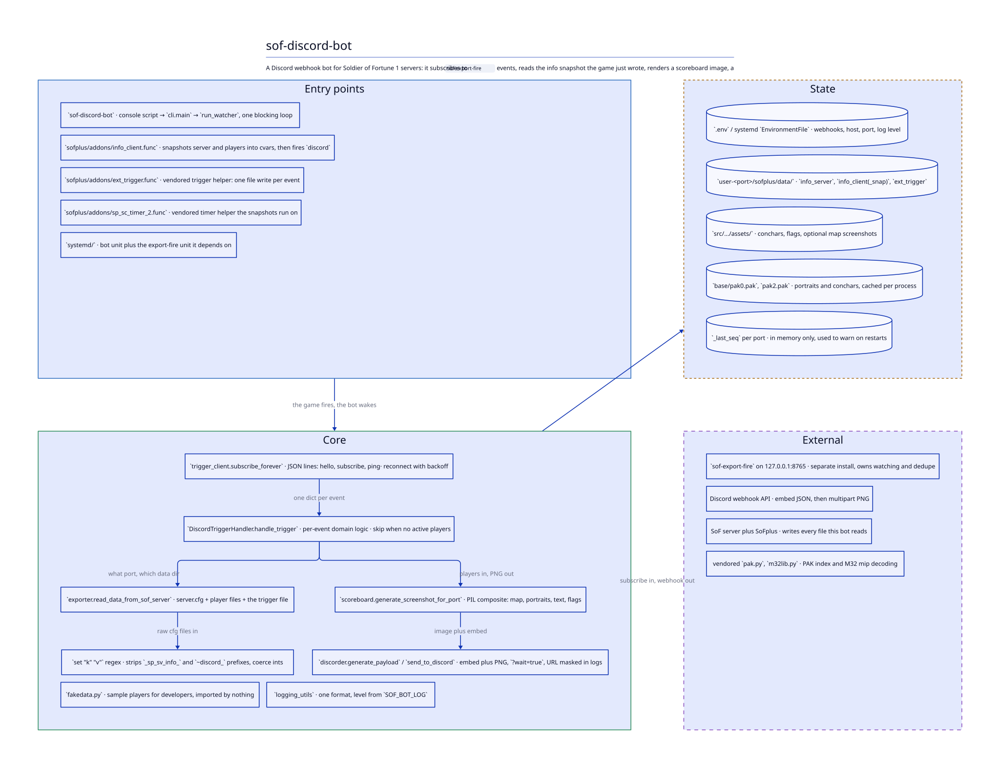

# sof-discord-bot

A Discord webhook bot for Soldier of Fortune 1 servers: it subscribes to `sof-export-fire` events, reads the info snapshot the game just wrote, renders a scoreboard image, and posts it to a channel.

Read it left to right:

- **This process watches nothing.** File watching, cooldown, settle time and trigger de-duplication all live in `sof-export-fire`, a separate install that owns the socket bus. The bot is one reconnecting subscriber (`trigger_client.py`) plus pure per-event domain logic (`handle_trigger`), which is why the interesting code is small and why running it without export-fire produces silence rather than errors — it will simply reconnect forever.
- **The hand-off is a folder of cfg files, not an API.** `info_client.func` writes `info_server/server.cfg` and per-player files under `info_client/`, optionally a frozen copy in `info_client_snap/`, and only then fires the `discord` trigger, whose `ext_trigger/discord.cfg` carries `name`, `seq`, `mode`, `slot` and `msg`. The bot prefers the snapshot directory when it exists and falls back to live files — so the freshness of a screenshot is decided by which directory the game happened to write, not by a timestamp.
- **The scoreboard is drawn from the game's own assets.** Portraits are decoded out of `pak0.pak` and `pak2.pak` (`.m32` mip data), and the console charset from `pics/console/conchars.m32` is used as a sprite font, both cached in module globals for the process lifetime. Map backgrounds are looked up by substring (`assets/sof_inter_ss/<map>.png`) then by full name (`assets/MAPS_SCREENSHOTS/<map_path>.png`), with a generic fallback so a missing screenshot degrades instead of failing.
- **A non-monotonic `seq` is reported, not fixed.** `_last_seq` remembers the last trigger per port and logs a warning when a sequence repeats or goes backwards — the signal that a server restarted and reset its counter. The event is still processed, so if export-fire ever forwards a replay across a reconnect, the same match can be posted twice; the log line is the only trace.
- **Secrets live only in the environment.** Webhook URLs come from `DISCORD_WEBHOOK_URL` / `DISCORD_WEBHOOK_URL_2` (two channels, one payload each), are never printed (only `id=… token=...abcd`), and each POST appends `?wait=true` so Discord returns a message id instead of an empty 204 — that id is the only way to tell "accepted" from "delivered". The `deprecated/` folder holds the previous monolithic scripts and is imported by nothing.

Diagram source: [`docs/system.d2`](docs/system.d2) · renderer: [`scripts/render-diagram.sh`](scripts/render-diagram.sh).
